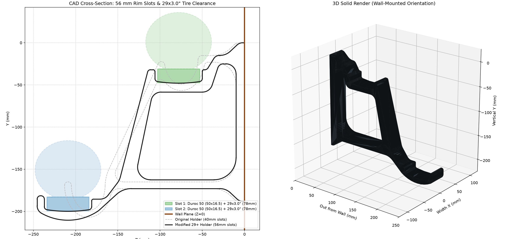
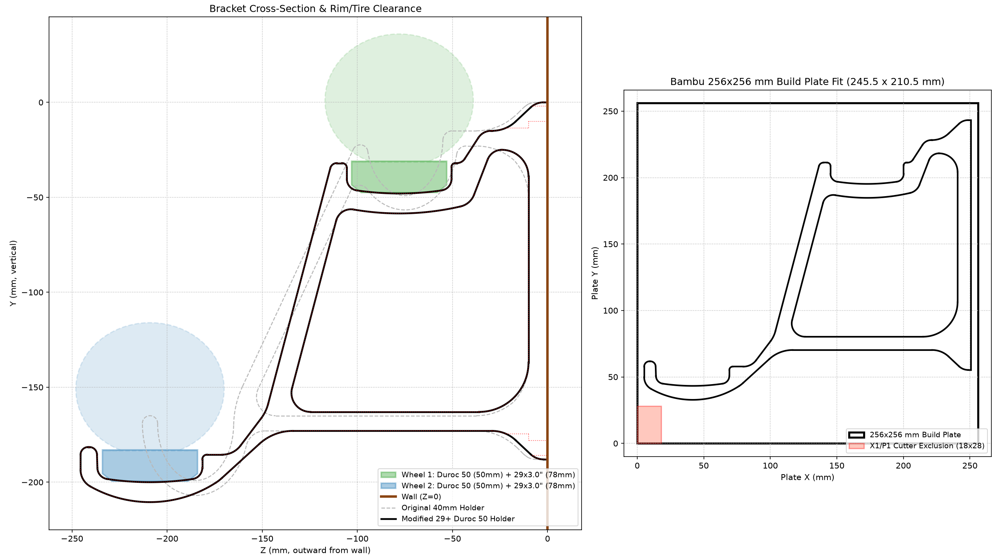
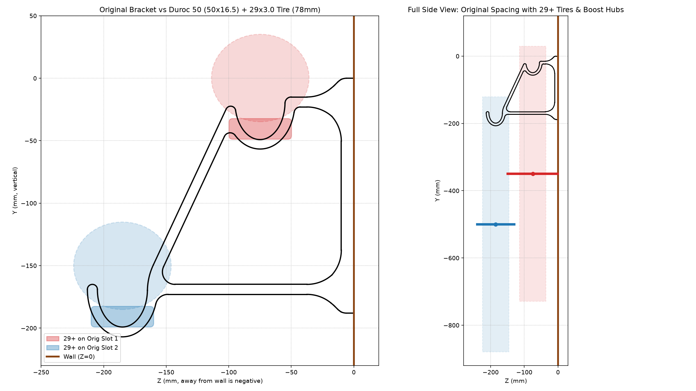

# 29+ (SUNringlé Düroc 50) Dual Bicycle Wheel Holder

Parametric CAD modification of Trykpaa's [MakerWorld Bicycle Wheel Holder (ID 1600179)](https://makerworld.com/en/models/1600179-bicycle-wheel-holder), redesigned to hold a pair of **29+ mountain bike wheels** (**2019 Trek Stache 7**: **SUNringlé Düroc 50** rims with mounted **29 × 3.0" Bontrager XR2** tires and Boost 110/148 hubs) while still fitting flat on a **256 × 256 mm** Bambu Lab build plate.

## Project Files

* **`Bicycle_wheel_holder_29plus_Duroc50.3mf`** — Ready-to-slice Bambu Studio 3MF project (`0.2 mm` layer height, `5` wall loops, `20%` infill, oriented flat on its side at `X = [5.25..250.75]`, `Y = [32.75..243.25]`, clear of the X1/P1 front-left cutter exclusion zone).
* **`Bicycle_wheel_holder_29plus_Duroc50.step`** — Clean B-Rep STEP CAD solid.
* **`Bicycle_wheel_holder_29plus_Duroc50.stl`** — Watertight binary STL mesh.
* **`generate_wheel_holder_29plus.py`** — Parametric `build123d` Python CAD generator script.

### Regenerating CAD / Mesh Files

```bash
uv run --with build123d python3 generate_wheel_holder_29plus.py
```

---

## Fit & Build-Plate Verification

### 1. Modified 29+ CAD Cross-Section & 3D Solid Render


### 2. Bambu 256 × 256 mm Build Plate Fit


### 3. Why Widening the Slots Alone Wasn't Enough (Original 40 mm Interference)
On the original `40 mm` holder, a `50 × 16.5 mm` Düroc 50 rim with a mounted `29 × 3.0"` (`~78 mm`) tire not only failed to enter the `40 mm` slots, its `3.0"` tire sidewalls also collided with the `30 mm`-deep vertical slot lips and cut `~12 mm` into the diagonal strut above the lower hook:



---

## Key Dimensional Changes

| Feature | Original Model | Modified 29+ Düroc 50 Model |
| :--- | :--- | :--- |
| **Clear Rim Slot Width (Both Slots)** | `39.6 – 40.0 mm` (`R=20` deep U) | **`56.0 mm`** (`3.0 mm` clearance/side on `50 mm` rim, `R=3.5 mm` bottom corners) |
| **Tire Sidewall Clearance (`29×3.0"` / `78 mm`)** | Collides with lips & diagonal strut | **Contoured `14.5–18.5 mm` rim lips + low-slung neck** (`>22 mm` strut clearance) |
| **Wheel-to-Wheel Z Center Spacing** | `110.2 mm` | **`131.0 mm`** (`53 mm` air gap between two `3.0"` tires; clears Boost 110/148 hubs) |
| **Inner Wheel Center to Wall (`Z_1`)** | `74.8 mm` | **`78.0 mm`** (`4 mm` endcap clearance for Boost `148 mm` rear hub) |
| **Strut & Hook Thickness** | `8.0 mm` | **`10.0 – 15.0 mm`** reinforced truss & tapered cantilever gusset |
| **Wall Mounting Holes** | `4×8 mm` slots @ `176 mm` c-to-c | **Identical** (`4×8 mm` slots + `15 mm` counterbores, flush `36 mm` wall face) |
| **Overall Footprint (`Depth × Height × Width`)** | `213.0 × 207.0 × 36.0 mm` | **`245.5 × 210.5 × 36.0 mm`** (`X=[5.25..250.75], Y=[32.75..243.25]` on `256×256` bed) |
| **Mesh Health & Volume** | Watertight (`235.83 cm³`) | **Watertight, manifold (`285.96 cm³`)** |
